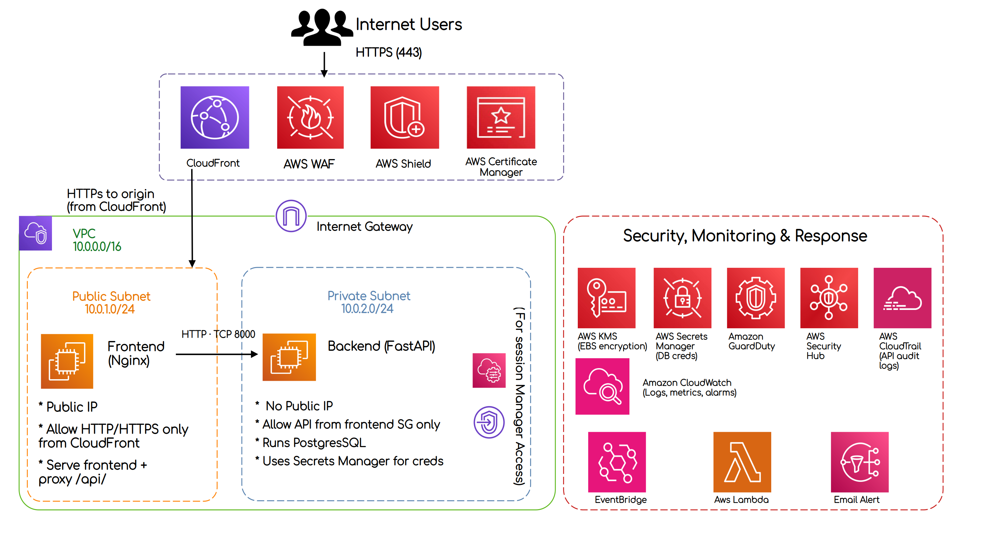
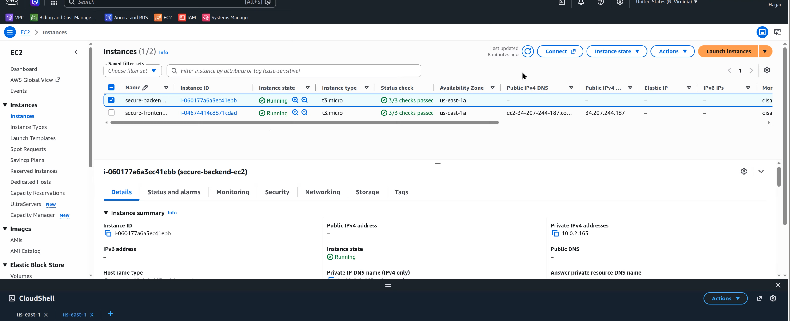
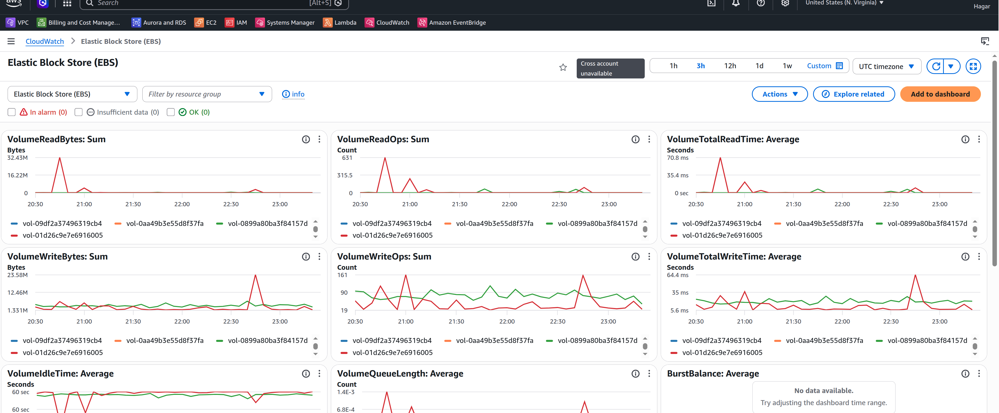
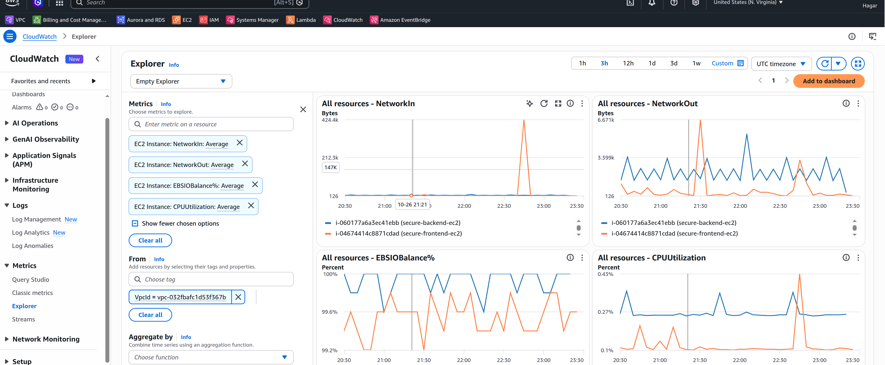
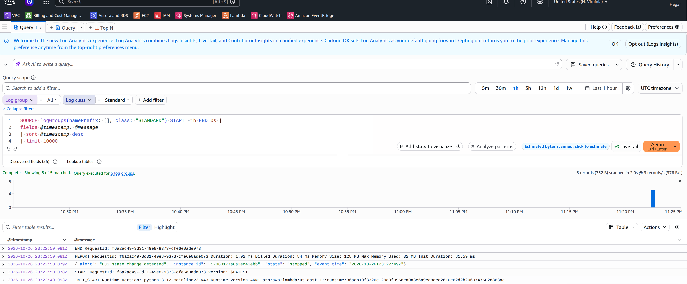
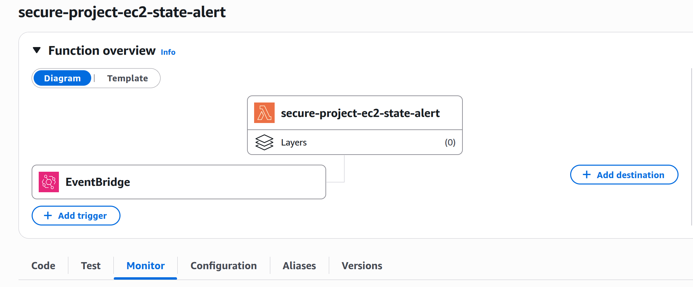
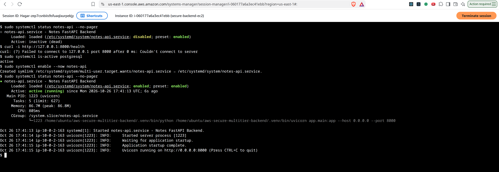
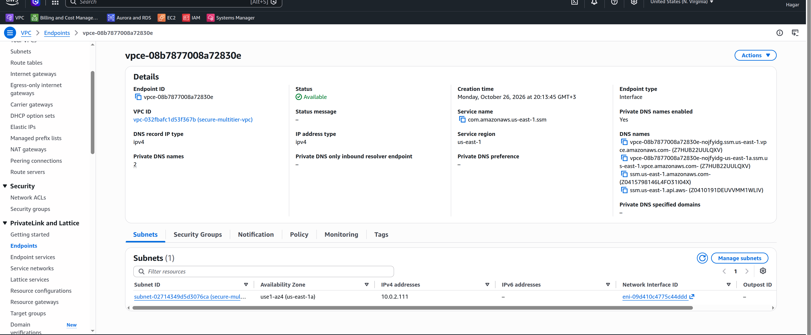
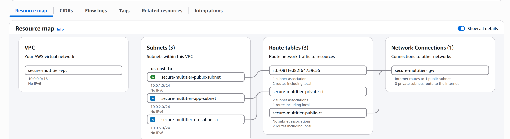
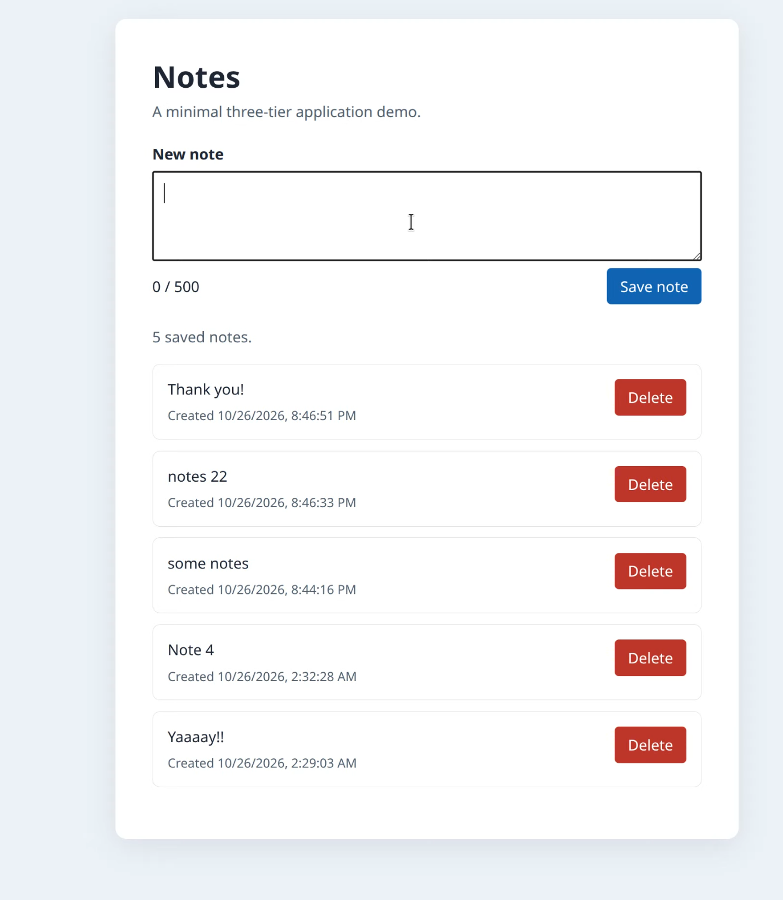

# Secure Multi-Tier AWS Architecture

> A security-focused AWS project demonstrating network segmentation, encryption, least-privilege access, and event-driven monitoring.

## Table of Contents

- [Project Overview](#project-overview)
- [Objectives](#objectives)
- [Proposed Architecture](#proposed-architecture)
- [Deployed Architecture](#deployed-architecture)
- [Security Controls](#security-controls)
- [Implementation Guide](#implementation-guide)
- [Event-Driven Monitoring](#event-driven-monitoring)
- [Budget and Design Trade-offs](#budget-and-design-trade-offs)
- [Challenges and Lessons Learned](#challenges-and-lessons-learned)
- [Validation and Evidence](#validation-and-evidence)

## Project Overview

This project explores the design and implementation of a security-focused, multi-tier application architecture on Amazon Web Services (AWS).

The proposed architecture emphasizes **defense in depth** through network segmentation, restricted service-to-service communication, encryption, secure credential management, web application protection, threat detection, audit logging, and event-driven response.

The application consists of a frontend hosted on Nginx, a FastAPI backend, and a PostgreSQL database. The proposed design introduces additional AWS security services, including Amazon CloudFront, AWS WAF, AWS Shield Standard, AWS KMS, AWS Secrets Manager, Amazon GuardDuty, AWS Security Hub, AWS CloudTrail, Amazon CloudWatch, Amazon EventBridge, and AWS Lambda.

Due to budget constraints, the deployed environment implements a subset of the proposed architecture. This project therefore documents both the **ideal target architecture** and the **budget-constrained implementation**, explaining the differences, design trade-offs, and lessons learned during deployment.

## Objectives

The primary objectives of this project are to:

- **Secure network communication:** Isolate application tiers and restrict inbound traffic using subnet boundaries and security groups.
- **Protect data and credentials:** Apply encryption at rest and in transit, and use AWS KMS and AWS Secrets Manager for key and secret management.
- **Protect the web application:** Use Amazon CloudFront, AWS WAF, and AWS Shield Standard to provide secure delivery and protection against common web threats and DDoS attacks.
- **Improve visibility and auditing:** Use AWS CloudTrail, Amazon CloudWatch, Amazon GuardDuty, and AWS Security Hub to support activity auditing, monitoring, and security findings.
- **Demonstrate event-driven response:** Use Amazon EventBridge and AWS Lambda to detect EC2 instance state changes and trigger automated processing.
- **Evaluate budget-driven trade-offs:** Compare the proposed security architecture with the deployed implementation, documenting deferred services, limitations, and lessons learned.

## Proposed Architecture

The proposed design uses a single VPC and Availability Zone, prioritizing security controls over high availability.

- **Edge protection:** Amazon CloudFront provides public HTTPS access, AWS WAF filters web requests, and AWS Shield Standard provides baseline DDoS protection.
- **Frontend tier:** An Nginx server on EC2 serves the frontend and proxies API requests. Access to the origin is restricted to CloudFront.
- **Backend tier:** A private EC2 instance runs FastAPI and PostgreSQL. Its security group permits API traffic only from the frontend security group.
- **Secure administration:** AWS Systems Manager Session Manager provides administrative access through private VPC endpoints.
- **Encryption and secrets:** AWS KMS supports EBS encryption, while AWS Secrets Manager stores database credentials.
- **Monitoring and response:** CloudTrail and CloudWatch provide audit and operational visibility. GuardDuty and Security Hub support security monitoring, while EventBridge and Lambda process selected events and trigger responses.

This architecture represents the **proposed target design**. Some components are not deployed in the budget-constrained implementation and are documented as planned improvements.

## Deployed Architecture

The deployed environment implements the core application and selected security controls within a single AWS Region (`us-east-1`).

- **VPC:** Custom VPC with separate public frontend and private backend subnets.
- **Frontend:** Public EC2 instance running Nginx, serving the frontend and proxying API requests.
- **Backend:** Private EC2 instance running FastAPI and PostgreSQL, without a public IP.
- **Network security:** Security groups restrict backend API access to the frontend security group.
- **Private administration:** AWS Systems Manager Session Manager, supported by IAM permissions and VPC interface endpoints.
- **Encryption at rest:** EBS root volumes are encrypted using AWS KMS with the AWS-managed EBS key.
- **Event-driven monitoring:** An Amazon EventBridge rule detects EC2 instance state-change events and invokes the `secure-project-ec2-state-alert` AWS Lambda function, which records event details in Amazon CloudWatch Logs.

The deployed environment does not include every component in the proposed architecture due to budget constraints.

## Security Controls

- **Network isolation:** Separate public and private subnets, with security groups restricting communication between tiers.
- **Encryption at rest:** EBS volumes encrypted using AWS KMS with the AWS-managed EBS key.
- **Secure administration:** Systems Manager Session Manager provides access to the private backend without requiring direct SSH access.
- **Audit and monitoring:** CloudTrail records AWS account activity, while CloudWatch collects application and monitoring logs.
- **Event-driven response:** EventBridge detects EC2 state changes and invokes Lambda to process and log the events.
- **Web protection:** CloudFront, AWS WAF, and AWS Shield Standard are included in the proposed architecture to provide secure content delivery, web request filtering, and baseline DDoS protection.

## Implementation Guide

This guide documents the proposed architecture enhancements that extend these foundations with edge protection, centralized secrets management, and additional security monitoring capabilities.

Components marked with * are implemented in the deployed environment. Other components describe the proposed target architecture.

### 1. Application Repositories

The application consists of two repositories:

- **Frontend:** [aws-secure-multitier-frontend](https://github.com/Hagar-Usama/aws-secure-multitier-frontend) - frontend application served by Nginx.
- **Backend:** [aws-secure-multitier-backend](https://github.com/Hagar-Usama/aws-secure-multitier-backend) - FastAPI application with PostgreSQL integration.

### 2. Network Infrastructure

A custom VPC named `secure-multitier-vpc` was designed with CIDR block `10.0.0.0/16`.

| Component | CIDR / Configuration | Purpose |
|---|---|---|
| Public subnet A* | `10.0.1.0/24` | Hosts the frontend EC2 instance |
| Private application subnet* | `10.0.2.0/24` | Hosts the backend EC2 instance |
| Database subnet A | `10.0.3.0/24` | Dedicated database-tier subnet |
| Database subnet B | `10.0.4.0/24` | Additional database subnet |
| Internet Gateway* | Attached to the VPC | Enables internet connectivity for the public subnet |
| Public route table* | `0.0.0.0/0 → IGW` | Routes public-subnet internet traffic |
| Private route table* | VPC-local route only | Keeps the backend subnet without a direct internet route |

The proposed design uses network segmentation to limit exposure and control traffic between application tiers. The deployed environment uses the public and private subnets; the database subnets are reserved for potential future separation of the database tier.

### 3. Application and Web Traffic

**Proposed design:**
- Amazon CloudFront provides the public entry point.
- AWS WAF filters web requests, while AWS Shield Standard provides baseline DDoS protection.
- AWS Certificate Manager provides the TLS certificate for HTTPS.
- The frontend origin accepts traffic through CloudFront to prevent direct bypass of the edge protections.
- Nginx serves the frontend and proxies API requests to the backend.

**Deployed implementation:**
- The frontend runs on a public EC2 instance with Nginx.
- The website is accessed over **HTTP**, not HTTPS.
- Nginx proxies `/api/` requests to the backend's private IP address on TCP port `8000`.
- CloudFront, WAF, Shield, and ACM are part of the proposed design, not the deployed traffic path.

### 4. Backend and Network Security

The backend runs FastAPI and PostgreSQL on a private EC2 instance without a public IP address.

- `secure-frontend-sg`* controls inbound web traffic to the frontend.
- `secure-backend-sg`* allows API traffic on TCP port `8000` from the frontend security group.
- The backend subnet uses a private route table without a NAT Gateway.
- The proposed design retains the backend in a private subnet and restricts access to required application traffic.

### 5. Secure Administration

The proposed design uses AWS Systems Manager Session Manager for administration without exposing SSH to the internet.

The deployed environment includes:

- An EC2 IAM role with `AmazonSSMManagedInstanceCore`*.
- The `ssm` and `ssmmessages` interface VPC endpoints*.
- Private DNS and VPC DNS configuration*.
- A dedicated endpoint security group* restricting HTTPS access to the backend security group.

### 6. Encryption and Secrets Management

**Proposed design:**
- Encrypt EBS volumes using AWS KMS.
- Store database credentials in AWS Secrets Manager.
- Use HTTPS/TLS for external web traffic and protect supported internal connections with encryption in transit.

**Deployed implementation:**
- EBS root volumes are encrypted using the AWS-managed EBS KMS key*.
- The frontend website currently uses HTTP, so browser-to-frontend traffic is not encrypted with TLS.
- AWS Secrets Manager integration is part of the proposed design.

### 7. Auditing, Threat Detection, and Response

The proposed design combines:

- **AWS CloudTrail** for AWS account activity auditing.
- **Amazon CloudWatch** for logs and monitoring.
- **Amazon GuardDuty** for threat detection.
- **AWS Security Hub** for security findings and posture visibility.
- **Amazon EventBridge** for event routing.
- **AWS Lambda** for automated event processing.
- **Amazon SNS** as an optional notification mechanism.

The deployed environment includes an EventBridge rule named `secure-project-backend-stop-rule`* that matches a backend EC2 stop event and invokes the Lambda function `secure-project-ec2-state-alert`*. The function records structured event details in CloudWatch Logs.

### 8. Validation

Validation includes checking website and API availability, verifying subnet routing and security-group restrictions, confirming EBS encryption, testing private administration through Session Manager, and verifying EventBridge-to-Lambda event processing.

## Event-Driven Monitoring

The project demonstrates event-driven monitoring using Amazon EventBridge and AWS Lambda, with Amazon SNS as a proposed extension for notifications.

### Event Flow

1. **Event source:** EC2 emits an instance state-change event.
2. **Event filtering:** The EventBridge rule `secure-project-backend-stop-rule` matches the configured backend instance entering the `stopped` state.
3. **Processing:** EventBridge invokes the Lambda function `secure-project-ec2-state-alert`.
4. **Logging:** Lambda records the instance ID, state, and event timestamp in Amazon CloudWatch Logs.
5. **Notifications (proposed):** Amazon SNS can be added to deliver email notifications or other supported alerts when an event requires attention.

This demonstrates event-driven infrastructure monitoring without requiring a continuously running monitoring process on the EC2 instance. The design can be extended to process additional infrastructure or security events and notify administrators when necessary.

## Budget and Design Trade-offs

The architecture prioritizes security while keeping deployment costs within a limited budget.

- **Least-privilege administration:** AWS resources were managed using an IAM user with appropriate permissions rather than routine use of the root account.
- **Budget monitoring:** An AWS Budget alert was configured to help monitor spending and identify when costs approach the planned budget.
- **Network isolation:** Public and private subnets, route tables, and security groups restrict communication between application tiers.
- **Secure administration:** Session Manager and VPC interface endpoints provide private administrative access without exposing SSH.
- **Encryption:** EBS volumes use encryption with the AWS-managed EBS KMS key.
- **Event-driven monitoring:** EventBridge and Lambda demonstrate infrastructure event processing, with CloudWatch Logs recording event details.
- **Proposed enhancements:** CloudFront, AWS WAF, AWS Shield Standard, Secrets Manager, GuardDuty, and Security Hub extend the design with additional web protection, credential management, and security visibility.

## Challenges and Lessons Learned

### 1. Missing Route-Table Association

**Issue:** The backend could not communicate as expected because its subnet was associated with an incorrect or incomplete route-table configuration.

**Resolution:** Corrected the subnet's route-table association and verified the intended private routing.

### 2. Session Manager Connectivity

**Issue:** AWS Systems Manager Session Manager could not initially establish a connection to the private backend instance.

**Resolution:** Configured the required `ssm` and `ssmmessages` VPC interface endpoints, enabled the necessary VPC DNS settings, and verified connectivity.

### 3. EBS Encryption Migration

**Issue:** The existing frontend root volume was initially unencrypted, and enabling encryption by default did not encrypt existing volumes.

**Resolution:** Created a snapshot, copied it with encryption enabled, created a replacement encrypted volume, and replaced the root volume while retaining the original for rollback during validation.

### 4. Budget-Constrained Design

**Challenge:** The full proposed architecture included services that would increase deployment costs.

**Approach:** Prioritized core network security, private administration, encrypted storage, and event-driven monitoring. Additional services were documented as proposed enhancements.

## Validation and Evidence

The deployed environment was validated through application testing, network configuration checks, and AWS service verification.

| Validation Area | Evidence |
|---|---|
| Application availability | Frontend loads successfully through Nginx. |
| API functionality | Backend health endpoint responds through the frontend's `/api/health` route. |
| Application integration | Frontend communicates with the FastAPI backend, which uses PostgreSQL for data persistence. |
| Network segmentation | The frontend resides in a public subnet, while the backend has no public IP and uses a private route table. |
| Security-group restrictions | Backend API traffic on TCP port `8000` is permitted from the frontend security group. |
| Private administration | Successfully connected to the backend using AWS Systems Manager Session Manager. |
| Storage encryption | Verified that the frontend root EBS volume uses encryption with the AWS-managed EBS KMS key. |
| Event-driven monitoring | Configured an EventBridge rule to invoke Lambda when the backend EC2 instance enters the `stopped` state. Verify the Lambda invocation and corresponding CloudWatch log entry before claiming end-to-end event processing was tested. |
| Budget monitoring | Configured an AWS Budget alert to help monitor project spending. |

### screenshots

